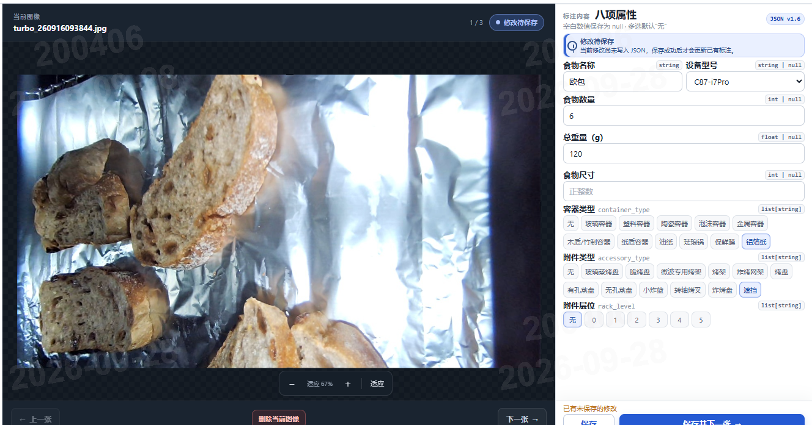
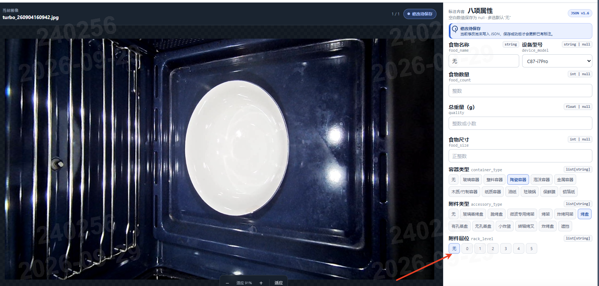
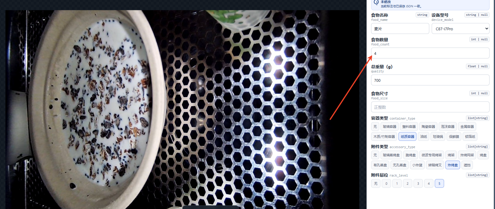
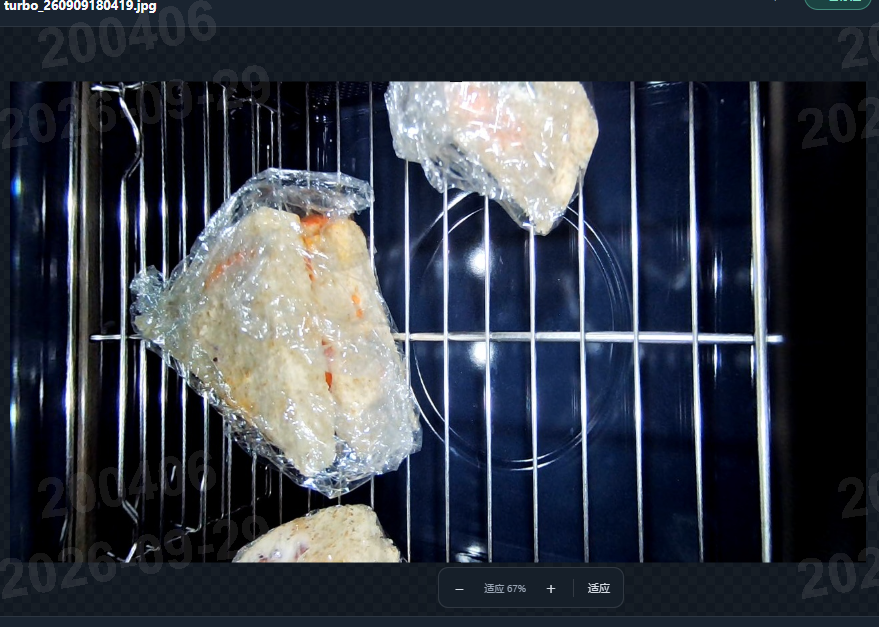
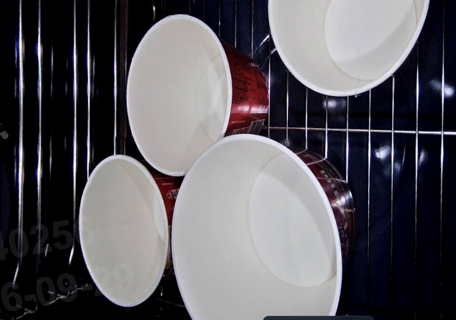
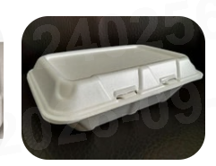
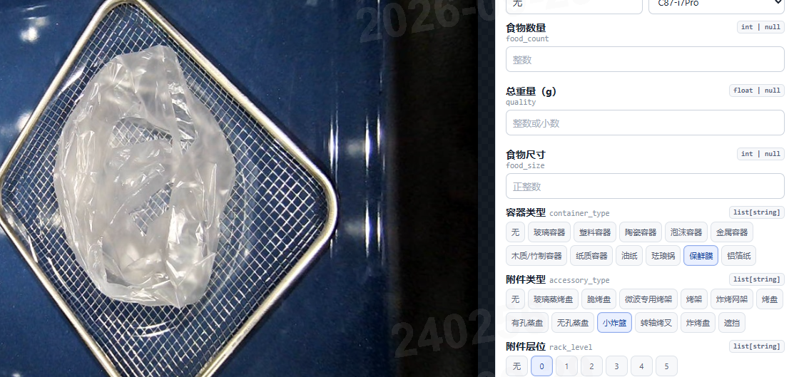
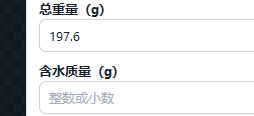

# 食物图像多属性标注规范

版本：V1.0 · 整理日期：2026-09-29  
适用对象：图像标注人员、复核人员  
适用工具：本项目多属性标注台（当前包含 9 个字段）

本文依据《王卓与姜欣的会话 2026年09月29日》中 9 月 28—29 日的讨论、随附截图及当前工具整理。同一问题以会话中最后明确确认的结论为准；未明确的业务口径集中列在第九节，不把临时讨论当作最终规则。

## 一、标注速查

| 遇到的情况 | 应如何填写 |
| --- | --- |
| 附件被遮住、当前图中看不到附件 | 附件类型选“遮挡”，不要直接选“无” |
| 确认没有附件 | 附件类型选“无”，层位选“无” |
| 有附件，放在设备底板上 | 层位选“0”，不要选“无”；设备允许范围见第四节 |
| 图中看不清层数，但已确认实际在第 5 层 | 层位选“5” |
| 食物完全被盖住，无法从当前图中辨认 | 食物名称填“无”；无法确定的数量留空 |
| 画面只看见部分食物 | 按可辨认的食物名称、数量填写，不沿用整组拍摄的原始数量 |
| 猪蹄汤只拍到黄豆 | 食物名称填“黄豆” |
| 本次会话中的泡面桶、纸碗 | 容器类型选“纸质容器”，纠正原“泡沫容器”标注 |
| 保鲜袋 | 按本项目约定，容器类型选“保鲜膜” |
| 普通食物 | “总重量（g）”填食物重量；“含水质量（g）”留空 |
| 绿豆汤等大量加水的食物 | “总重量（g）”填食物重量；“含水质量（g）”填食物加水的合计重量 |

**“无”“遮挡”“0”和留空含义不同。** “遮挡”是附件类型选项；“0”是实际底板层；数值留空表示未填写，保存后为 `null`，不能用数字 `0` 代替未知。

## 二、基本原则与操作流程

### 2.1 基本原则

1. **按字段使用证据。** 食物名称、数量及可见包装以当前图片为依据；重量、设备型号、已确认的实际层位应核对采集记录或现场信息，不靠图片猜数值。
2. **逐张检查。** 同一批次、同一食物的不同照片可能有遮挡、裁切或拍摄角度变化，不能机械复制上一张的名称、数量和包装标签。
3. **多选只填写适用项。** 容器类型、附件类型、层位支持多选。“无”不能与其他选项同时存在；多个不同类型确实同时出现时，分别勾选。
4. **不确定的问题要可追溯。** 先保留能确认的信息，把疑问登记到独立清单，待确认后回填。当前工具没有备注框。
5. **保存状态不等于复核通过。** 页面显示“已标注”只说明存在已保存的标注，需要按本文检查内容是否正确。

### 2.2 每张图片的操作顺序

1. 核对当前数据文件夹、设备型号和图片文件名。
2. 查看整张图片，必要时放大，判断食物是否可见、能辨认出几个独立个体。
3. 填写食物名称和食物数量；核对重量记录，分别填写两种重量。
4. 判断容器与包装，检查是否真的存在保鲜膜、保鲜袋或铝箔纸。
5. 判断附件类型，再核对实际层位；重点区分“无”“遮挡”和“0”。
6. 有明确尺寸记录且单位、测量口径已统一时，填写食物尺寸。
7. 按第七节自检，点击“保存”或“保存并下一张”，确认保存成功。

### 2.3 常用操作

| 操作 | 按钮或快捷键 |
| --- | --- |
| 保存当前图片 | “保存”或 `Ctrl + S`（Mac 为 `⌘ + S`） |
| 保存后进入下一张 | “保存并下一张”、`E` 或 `Ctrl / ⌘ + Enter` |
| 上一张 / 下一张 | 页面按钮，或 `Q` / `W` |
| 切换标注目录 | 右上角“切换文件夹”，选择服务器上的任务目录 |

输入框内的单字母按键用于输入文字，不触发上述单字母快捷操作。单纯翻页不会自动保存；出现未保存提示时，先保存需要保留的修改。

## 三、字段填写规则

### 3.1 食物名称

填写当前画面中能辨认的食物名称，同类食物保持命名一致。

- **只看到部分食材：** 按可见食材命名。会话已确认：猪蹄汤画面只看到黄豆时，填写“黄豆”，不继续填写“猪蹄汤”。
- **食物完全不可见：** 例如盖子遮住内容物，填写“无”；不能仅凭拍摄计划或上一张图片补出名称。
- **只拍到空容器：** 食物名称填写“无”，容器和附件仍分别按实际情况填写。
- **多种食物同时出现、名称难以统一：** 登记确认，不自行发明编号或多名称拼接格式。工具当前只有一个名称输入框。

### 3.2 食物数量

填写当前图片中能够辨认出的独立食物个体数量，只填整数。

- 不直接沿用现场摆放的总数。原来放了 4 个或 6 个，但当前照片已拍不全时，需要重新判断可见数量。
- 部分个体被图片边缘截断，**仍能确认其为独立个体**时可以计入。附录图 4 的三个独立食物中有部分未完整入镜，会话明确确认数量为 `3`。
- 遮挡、重叠导致无法确认数量时，留空并登记，不估计被遮住的个数。
- 看不见食物时，不在数量框输入文字“无”；数值未知时留空。工具允许 `0`，但不要把它当成“看不清”的默认值。
- 汤、粥、散粒食物是否按碗、按份计数，以及“明确无食物”时统一填 `0` 还是留空，原会话未完整规定，见第九节。

### 3.3 总重量（g）与含水质量（g）

**采用 9 月 29 日 13:50 最终确认的双字段口径。** 两个框均以克为单位，支持整数或小数；只填写数值。

| 食物情况 | 总重量（g） | 含水质量（g） |
| --- | --- | --- |
| 普通食物，无需单独记录加水后的质量 | 食物重量 | 留空 |
| 绿豆汤、猪蹄汤等大量加水的食物 | 食物本身的重量 | 食物与所加水的合计重量 |
| 缺少称重记录 | 未知项留空并登记 | 未知项留空并登记 |

以下为填写示例，数值仅用于说明规则：

| 场景 | 总重量（g） | 含水质量（g） |
| --- | ---: | ---: |
| 普通面包，食物重 320 g | 320 | 留空 |
| 绿豆重 200 g，加水后合计 1200 g | 200 | 1200 |
| 食物重 239 g，加水后合计 1032 g | 239 | 1032 |

填写时注意：

- 这里的“总重量”按本项目约定指食物重量，**不是容器、附件和食物的称重总和**；称重记录若含容器，应先核对皮重。
- “含水质量”是食物加水后的合计重量，**不是单独的水重，也不是含水百分比**。
- 不再使用 `1032.239`、`1200.200` 这种把两种重量拼在一个数字里的旧写法。工具会把它们当作一个小数，尾部的零也可能被省略。
- 两个重量框独立输入，工具不会自动计算或校验二者关系。同一称重口径下，含水质量应不小于食物重量；异常时核对记录。
- 历史拼接数据必须查原始称重记录后拆分，不能只根据小数位猜。例如 `1200.2` 无法可靠说明原来想写的是 2 g、20 g 还是 200 g。
- 图片只拍到部分食物时，不按可见个数擅自折算重量；原记录对应整组还是当前画面，需要按第九节确认。

### 3.4 设备型号

按实际拍摄设备选择，当前可选：`C9277A`、`CQ09-i9`、`C87-i7Pro`、`DB677`。

型号未知时保留“未指定”，登记待核实，不根据附件外观推测型号。型号与层位必须一起检查，允许的组合见第四节。

### 3.5 容器类型

容器用于盛放、承托或包装食物，例如碗、盘、保鲜袋、铝箔纸。它与设备附件分开填写：**陶瓷碗放在烤盘上，应分别填写容器“陶瓷容器”和附件“烤盘”。**

当前可选项：无、玻璃容器、塑料容器、陶瓷容器、泡沫容器、金属容器、木质/竹制容器、纸质容器、珐琅锅、保鲜膜、铝箔纸。

重点规则：

- **纸碗、泡面桶与泡沫盒：** 本次会话中原误标为泡沫的纸碗、泡面桶，已确认改为“纸质容器”。不能因名称中有“泡面”或外观为白色就标“泡沫容器”。真正的泡沫盒另行辨认，示例见附录图 5。
- **保鲜袋：** 会话最终确认按“保鲜膜”标注，不采用讨论中临时提出的“塑料容器”。
- **保鲜膜：** 仅在画面中确实可辨认到膜或袋时勾选。玻璃容器的反光、边缘不能直接当作保鲜膜。
- **多个类型：** 例如可见陶瓷碗且覆盖保鲜膜，可同时选择“陶瓷容器”和“保鲜膜”。不要因烤盘是金属材质，就自动额外勾选“金属容器”。
- **没有容器或包装：** 选择“无”。材质存在疑问时，放大检查或核对实物，仍无法确认则登记复核，不随意猜一种材质。

“泡沫容器”仍是工具中的有效选项；本次修正针对具体误标样本，不表示该类别已经取消。

### 3.6 附件类型

附件指设备中使用的烤盘、烤架、蒸盘、炸篮等。

当前可选项：无、玻璃蒸烤盘、脆烤盘、微波专用烤架、烤架、炸烤网架、烤盘、有孔蒸盘、无孔蒸盘、小炸篮、转轴烤叉、炸烤盘、遮挡。

| 判断结果 | 填写方式 |
| --- | --- |
| 附件可见且能确认类型 | 选择对应附件 |
| 附件被食物、容器、铝箔等遮住，看不到 | 选择“遮挡” |
| 确认没有使用附件 | 选择“无” |
| 附件可见，但分不清具体型号或类别 | 核对附件样表或实物并登记确认，不把“不认识”直接当成“遮挡” |

不要因为附件没有推到最里面，就自行更改其类别或判定不适配。会话中的炸烤盘已确认适配，位置异常可能只是未推到顶。

### 3.7 层位

界面也可能显示为“附件层位”。选择实际使用附件的位置，支持多选。详细判断顺序见第四节。

### 3.8 食物尺寸

当前输入框仅接受正整数，也可留空。会话和工具尚未规定尺寸的单位、测量方向及含义。

有统一的任务说明和测量记录时按该口径填写；未明确前留空并登记，不能自行按厘米、毫米、直径或容器尺寸填写。不要用 `0` 表示未知。

## 四、附件与层位的联合判断

先判断“有没有附件、能否看见附件”，再判断“实际在哪一层”。这两个字段表达不同信息。

| 实际情况 | 附件类型 | 层位 |
| --- | --- | --- |
| 没有附件，容器直接放在设备底板上 | 无 | 无 |
| 有烤盘，烤盘放在底板上 | 烤盘 | 0（型号允许时） |
| 可确认附件类型和实际层位 | 对应附件 | 实际层位 |
| 附件可见，层位在图中不清楚，但采集记录确认在第 5 层 | 对应附件 | 5（型号允许时） |
| 附件被遮挡，但实际层位有可靠记录 | 遮挡 | 已确认的实际层位 |
| 附件被遮挡，层位也无可靠依据 | 遮挡 | 暂留“无”，登记待复核，不凭空猜层数 |

最后一行是**待负责人确认的临时处理建议**，并非会话已明确的最终口径。不能把这里的“无”当成实际没有层位的结论，也不能据此将该样本视为已完成复核。

**有附件放在底板上才使用“0”；没有附件时使用“无”。** 会话中两种情形均有明确示例，不能把所有在底部的物体都统一标为“0”。

按项目说明，型号与层位对应关系如下：

| 设备型号 | 允许的实际层位 |
| --- | --- |
| C9277A | 0、1、2、3、4、5 |
| C87-i7Pro | 0、1、2、3、4、5 |
| CQ09-i9 | 0、1、2、3 |
| DB677 | 1、2 |
| 型号未指定 | 层位选“无”，先核实型号 |

没有附件时仍按“无”处理。型号未知但实际层位已有可靠记录时，先把已知层位记入疑问清单，核实型号后回填，不丢弃原始记录。若现场记录与上表冲突，例如 DB677 记录为底板层，登记确认，不强行套用其他设备的层位。当前页面不会自动阻止所有型号与层位不匹配的组合，需要人工检查。

## 五、容易混淆的案例

| 案例 | 正确处理 | 应避免的写法 |
| --- | --- | --- |
| 附件被铝箔遮住 | 容器“铝箔纸”；附件“遮挡”；层位单独核实 | 因看不到附件就填“无” |
| 烤盘放在底板上，碗放在烤盘里 | 容器按碗的类型；附件“烤盘”；层位“0” | 附件有值，层位却误写“无” |
| 图片看不到搁架刻度，实际确认在第 5 层 | 层位“5” | 只因看不见刻度而改为“无” |
| 原来有 4 份，当前照片已拍不全 | 重新按当前可辨认个体计数 | 沿用原数量“4” |
| 三个食物中，有个体只露出一部分，但仍能区分 | 会话图例确认数量为“3” | 要求完整入镜才计数，或补算完全看不见的个体 |
| 只有带盖容器，看不到食物 | 食物名称“无”；不能确定数量时留空；容器和附件照常标 | 根据容器或前后帧猜食物名称 |
| 猪蹄汤画面只见黄豆 | 食物名称“黄豆” | 继续填写画面中不可见的“猪蹄汤” |
| 泡面桶或纸碗曾被标为泡沫 | 按已确认结果改为“纸质容器” | 因外观白色就选“泡沫容器” |
| 保鲜袋包裹食物 | 容器包含“保鲜膜” | 把保鲜袋一律改成“塑料容器” |
| 玻璃碗边缘有反光，但没有膜 | 保留正确容器类型，不选“保鲜膜” | 把反光当成膜 |
| 食物 200 g，加水后 1200 g | 总重量“200”；含水质量“1200” | 在总重量框填“1200.200” |

## 六、历史数据返查

建议按以下顺序返查，本节是复核流程建议，不代表历史数据已全部修正：

1. **附件类型为“无”的样本：** 检查是否实际属于附件被遮挡；是则改为“遮挡”。
2. **层位为“无”的样本：** 区分确实无附件、底板上的附件和已知实际层位，分别保留“无”或改为对应数字。
3. **数量曾整批复用的样本：** 逐图核对遮挡、裁切后的可辨认数量，尤其检查会话提到的 9 月 24 日及 9 月 28 日相关图片。
4. **容器为“泡沫容器”的样本：** 重点检查纸碗、泡面桶误标。
5. **容器包含“保鲜膜”的样本：** 核对是否真的可见膜或袋，去掉把玻璃反光误判为膜的标签。
6. **旧版汤类重量：** 查找曾采用拼接写法的记录，对照原始称重信息拆到两个字段。
7. **食物名称与可见内容不一致的样本：** 检查盖住食物、只见配料、部分食材出画等情况。

可用“数据筛查”筛选已保存的属性，再逐张复核。修改后一定保存；当前图片不再符合筛选条件时，列表可能自动转到其余匹配结果。

## 七、保存前与交付前检查

### 7.1 每张图片保存前

- [ ] 名称与当前可见食物一致；不可见时没有凭记录补出食物名称。
- [ ] 数量已按当前图片检查，没有照搬现场总数；无法判断的数值已留空。
- [ ] 总重量与含水质量分开填写，单位均为 g，没有使用拼接写法。
- [ ] 容器、包装和附件已分开判断，保鲜膜确实可见。
- [ ] “无”“遮挡”和“0”使用正确，已知实际层位没有误写为“无”。
- [ ] 设备型号与层位匹配。
- [ ] 尺寸有明确单位和测量依据；没有依据的尺寸没有猜填。
- [ ] 疑问已登记，点击保存后显示成功；保存后继续改动的内容已再次保存。

### 7.2 一批任务交付前

- [ ] 已核对未标注、异常标注和疑问清单，没有把疑问样本当成已复核通过。
- [ ] 已完成重点易错项返查，修正内容均已保存。
- [ ] 下载前确认当前目录正确，所需图片和标注属于本批任务。
- [ ] 抽查导出表中的文件名、两种重量、附件和层位与保存结果一致。

“下载已标注数据”导出当前文件夹及其子目录的已保存原图和 `标注数据.xlsx`；**筛选条件不会缩小下载范围，未保存的修改不会进入导出，下载包不含同名 JSON。** 若交付需要 JSON，应另行保留图片旁的同名 JSON 文件。

“删除当前图像”会在确认后永久删除原图和同名 JSON。不要用删除表示“暂时看不清”或“等待确认”。

## 八、疑问登记模板

工具没有备注字段，可在任务共享表或独立文档中按下表登记。图片用相对路径定位，避免子目录中同名文件混淆。

| 图片相对路径 | 疑问字段 | 图片现象 / 已知记录 | 当前填写 | 待确认事项 | 确认结论、确认人及时间 | 是否已回填保存 |
| --- | --- | --- | --- | --- | --- | --- |
| 示例：批次A/food_001.jpg | 层位 | 附件被遮挡，缺少层位记录 | 附件“遮挡”，层位“无” | 实际层位及设备型号 | 待确认 | 否 |

确认后回到对应图片修改并保存，再更新清单。该清单用于补充追踪，不替代正式标注。

## 九、待统一的业务口径

以下事项在现有会话和代码中没有完整定义。遇到相关样本时登记确认，不能把建议写成已确认事实。

| 待确认事项 | 需要明确的内容 | 未明确前的处理 |
| --- | --- | --- |
| 食物尺寸 | 单位、测量方向、测量对象；是否为直径、边长或其他指标 | 留空，不填容器尺寸代替食物尺寸 |
| 汤、粥和散粒食物数量 | 按碗、按份还是其他单位计数 | 不自行逐粒计数或一律填 1，登记确认 |
| 明确没有食物时的数量 | 统一填 0 还是留空 | 建议暂留空，待负责人统一 |
| 一图多种食物的名称及数量 | 命名格式、数量是否汇总、混合菜如何命名 | 保留能确认的信息，登记确认 |
| 图片仅拍到原批次的一部分 | 重量对应当前可见部分还是采集整组；称重时点及范围 | 保留原始称重依据，不按数量比例推算 |
| 层位或容器类型无法确认 | 是否补拍、查采集记录，以及最终如何交付这些样本 | 在清单中保留待复核状态 |

## 附录：会话图例与依据

下列图片摘自用户提供的会话，保留原图。**截图中选中的旧值可能正是待纠正项，培训时以图下说明和正文规则为准。** 图片中的旧界面标题“八项属性”不代表当前字段数量。

### 图 1：附件被遮挡

来源：9 月 28 日 13:22。会话确认这种看不到配件的情况，附件类型选“遮挡”；不能据此推断层位也必须为“无”。

### 图 2：有附件放在底板，层位应为 0

来源：9 月 29 日 14:28—14:29，图片 `turbo_260904160942.jpg`。会话确认“这是 0 层”，截图中的层位“无”是需要纠正的旧值。

### 图 3：拍不全时不能照搬数量

来源：9 月 29 日 09:14。会话指出“看不到 4 个了已经”，要求重新核对当前画面；这里没有给出修正后的具体数值，不把示例擅自写成某个新数量。

### 图 4：部分入镜但可确认独立个体，数量为 3

来源：9 月 29 日 13:37，图片 `turbo_260909180419.jpg`。针对这张图，双方明确确认可以算三个。

### 图 5：纸质容器与泡沫盒的区别

来源：9 月 29 日 11:53—12:05。结合后续确认，本次这类泡面桶按“纸质容器”修正。

来源：9 月 29 日 11:58。此图是会话用于说明泡沫盒的参照，不能据此把所有白色一次性容器都判为泡沫。

### 图 6：保鲜袋按保鲜膜标注

来源：9 月 29 日 12:10—13:05。最终确认保鲜袋按“保鲜膜”的方式标注。

### 图 7：含水质量已独立为一个输入框

来源：9 月 29 日 13:50。最终确认普通食物填总重量；大量加水的食物，总重量填食物重量，含水质量填食物加水的合计重量。

### 依据索引

| 规则 | 会话时间或项目依据 |
| --- | --- |
| 已知实际层位按实际填写 | 2026-09-28 10:58—11:00 |
| 附件不可见改用“遮挡” | 2026-09-28 12:01、13:22 |
| 无附件时层位“无”；附件放底板时为“0” | 2026-09-28 16:47—16:48；2026-09-29 14:28—14:29 |
| 根据可见情况复核食物及数量 | 2026-09-29 09:10—09:16、13:37、14:55 |
| 泡面桶等纸质容器纠正误标 | 2026-09-29 12:04—12:07 |
| 保鲜袋按保鲜膜标注 | 2026-09-29 13:05 |
| 两个重量字段的最终含义 | 2026-09-29 13:50 |
| 当前字段、枚举及输入限制 | [config.py](../annotation_app/config.py)、[models.py](../annotation_app/models.py)、[界面代码](../annotation_app/static/index.html) |
| 快捷键、保存与下载行为 | [app.js](../annotation_app/static/app.js)、[项目说明](../README.md) |
| 型号与层位对应范围 | [项目说明](../README.md)中的“Linux 服务器注意事项” |
